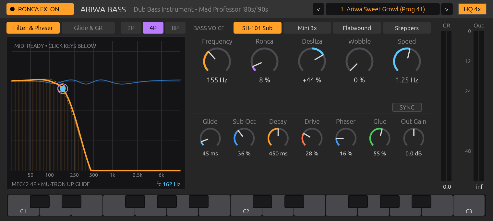
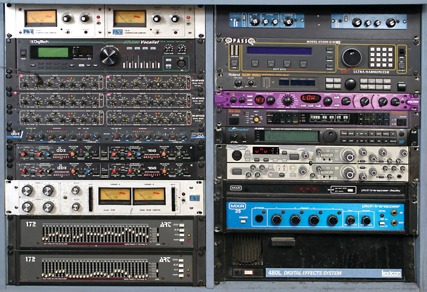

# Ariwa Bass — Mad Professor's '80s/'90s "Ronca e Desliza" Dub Bass Instrument

[](https://github.com/nagualcode/ariwabass)
[](LICENSE)
[](#installation)

**Ariwa Bass** is a zero-allocation, real-time analog modeling **Dub Bass Instrument (VST3, CLAP, Audio Unit, and Standalone)** built in Rust using the [Truce](https://github.com/truce-audio/truce) framework.

It reconstructs the legendary 1980s and 1990s **"ronca e desliza"** (*sweet psychedelic growl and slide*) bass effect pioneered by **Neil Fraser (Mad Professor)** at the historic **Ariwa Sound Studios** (Thornton Heath, South London) — the liquid, organic, and vocal sub-bass movement heard across landmark albums such as *Dub Me Crazy*, *Black Liberation Dub*, *Jah Shaka Meets Mad Professor*, and Massive Attack's *No Protection*.





---

## 🔬 Forensic Research & Hardware Modeling

The DSP architecture of **Ariwa Bass** models the exact analog and hybrid outboard signal chain photographed in Mad Professor's personal Ariwa rack (*Sound On Sound*, August 2007) combined with component-level physics, service manuals, and historic audio patents:

```mermaid
flowchart LR
    Voice["Bass Voice Generator<br/>(SH-101 / Mini 3x / Flatwound / Steppers)"] --> Tape["0. Otari MTR-90 2\" Tape & 1/f Flux<br/>(61.87 Hz Head Bump + Class-A H2)"]
    Tape --> Split{"SSL Console In-Line Split"}
    Split -->|"Sub Anchor (<95 Hz) + Dry"| Mix["Phase-Coherent Parallel Sum"]
    Split -->|"Dub FX Path (Wet)"| MXR129["1. MXR Model 129 Pitch Transposer<br/>(-1 Oct Companded + 555 VCO Glide)"]
    MXR129 --> Filter["2. Akai MFC42 (SSM2164S 2P/4P/8P SVF)<br/>+ Line 6 Filter Pro (Prog 41 'LOW' / Mu-Tron III)"]
    Filter --> Diode["3. 1SS133 Silicon Diode Growl<br/>(4x Kaiser Linear-Phase Oversampling)"]
    Diode --> Phaser["4. MXR Series 131 (M-110)<br/>(Dual 6-Stage Vactrol Auto Phaser)"]
    Phaser --> Glue["5. UREI LA-4 (CdS Optical)<br/>+ dbx 166 (True-RMS VCA + PeakStop)"]
    Glue --> Mix
```

### 1. Why the Ariwa Bass Sound is "Sweet and Psychedelic" (Not Aggressive)

1. **Cascaded 2-Pole / 4-Pole / 8-Pole SSM2164S State-Variable Filter (Akai MFC42):**
   - The **Akai MFC42** analog filter module utilizes **5x `SSM2164S`** quad exponential VCAs ($-33\text{ mV/dB}$ control law) with `NJM2082M` JFET operational amplifiers.
   - In 8-Pole Mono mode ($-48\text{ dB/octave}$), four 2-pole SVF blocks cascade in series:
     $$H_{8\text{P}}(s) = \left(\frac{\omega_c^2}{s^2 + \frac{\omega_c}{Q}s + \omega_c^2}\right)^4$$
   - This steep slope eliminates all harsh high frequencies above $600\text{–}1200\text{ Hz}$, locking the resonant energy strictly into the human chest/throat vocal formant region ($80\text{–}450\text{ Hz}$).
2. **Post-Filter `1SS133` Silicon Diode Throat Growl ("Ronca"):**
   - Anti-parallel `1SS133T-77` silicon diodes gently saturate the signal inside the resonator loop and at the `NJM4558M` post-filter driver stage.
   - Because the input to the clipper is pre-filtered by 24 dB or 48 dB per octave, intermodulation distortion (IMD) is virtually zero. It generates pure, musical second and third harmonics ($H_2 > H_3$) that sound like an organic, purring throat rather than harsh digital fuzz.
3. **Photoconductive CdS Optocoupler Envelope ("Desliza") — US Patents 3,911,776 & 5,789,689:**
   - In `MadProfessor_3a.jpg`, the purple **Line 6 Filter Pro** is dialed to **Program `41`** with the screen displaying **`LOW`** (Low-Pass Filter with Mu-Tron III envelope follower dynamics).
   - Cadmium Sulfide (CdS) photoresistors follow a dual-stage photoconductive decay ($\tau_1 \approx 35\text{ ms}$, $\tau_2 \approx 185\text{ ms}$) governed by the power law $R_{\text{opt}} \propto I_{\text{LED}}^{-\gamma}$.
   - **`Tron Up` (`Desliza > 0%`)**: Sweeps upward through the vocal formants on note attack.
   - **`Tron Down` (`Desliza < 0%`)**: Program 41 plunge starting elevated and diving down into the sub-bass fundamental.
4. **MXR Model 129 Pitch Transposer Sub-Octave (Tony Gambacurta, 1978):**
   - Dual-head $180^\circ$ crossfading circular buffer ($\Delta T \approx 25.6\text{ ms}$) with an **XOR Polarity Correlator** (`U25` + `U16` XOR gate) that phase-aligns splices, combined with **`Am6072` $\mu$-255 companding** and a 555 VCO pitch glide.
5. **Dual MXR Model 131 (M-110) 6-Stage Vactrol Auto Phaser:**
   - Six cascaded first-order all-pass stages with Vactrol LED/LDR control above a $95\text{ Hz}$ crossover (keeping the sub-bass 100% mono-anchored and phase-stable) producing 3 deep comb notches ($0.268 f_0, 1.0 f_0, 3.732 f_0$) in stereo quadrature.
6. **UREI LA-4 Optical Compressor + dbx 166 (US Patents 3,681,618 & 3,714,462):**
   - David Blackmer's True-RMS logarithmic power detector, OverEasy® soft knee, $82\text{ k}\Omega$ CdS optical release memory, and PeakStop® diode limiter clamping resonant peaks into a warm cushion of sub-bass.

---

## 🎹 Synthesizer Architecture & Dynamic Bass Containment

To ensure the instrument sits tightly in a mix without runaway drones or background whistling, **Ariwa Bass** incorporates containment principles from classic bass synthesizer patents (**Roland TB-303 / Tadao Kikumoto US Patent 4,635,521** and Bob Moog's Minimoog):

1. **Contained VCA & VCF Decay Envelopes:**
   - Ultra-fast $1.8\text{ ms}$ click-free analog attack.
   - Exponential decay contour ($80\text{ ms}$ to $2.5\text{ s}$) with a low, controlled sustain floor ($\le 0.25$), preventing notes from turning into endless droning organs.
   - Snappy $25\text{ ms}$ release on `NoteOff`, cutting off any filter ring or feedback immediately.
2. **Dynamic Resonance Damping (`Ronca`):**
   - Resonant Q peak ($Q \le 5.2$) bites on note attack and decays smoothly with the note, preventing endless whistling self-oscillation while notes are held.
   - **By default, all factory presets are configured with `Ronca` $\le 10\%$**, ensuring clean, round, punchy sub-bass out of the box.
3. **Note-Triggered Synchronized Wobble LFO:**
   - LFO phase resets on every `NoteOn` for perfect rhythmic alignment.
   - Modulation depth is scaled by the note envelope, allowing subtle, musical dub movement ($\pm 0.55$ octaves) that settles naturally.
4. **4 Dedicated Bass Voice Models:**
   - **`SH-101 Sub`**: Roland SH-101 / Juno-60 PolyBLEP Sawtooth + Pulse + phase-locked $-1\text{ Oct}$ Sub.
   - **`Mini 3x`**: Triple detuned Moog Minimoog Model D oscillator stack ($0$, $+7.5$, $-7.5$ cents).
   - **`Flatwound`**: Physical model of a plucked Fender Jazz/Precision bass with flatwound strings.
   - **`Steppers`**: 1990s UK Dub / Jah Shaka steppers bass (pure phase-locked Sine sub + detuned Saws).

---

## 🎛️ Parameters & Interface (Ableton Live Inspired)

| Parameter | Range | Description |
| :--- | :--- | :--- |
| **`RONCA FX: ON / CLEAN SUB`** | Toggle | Master switch for the "Ronca e Desliza" effect chain (Clean Dub Sub when Off). |
| **`Bass Voice`** | 4 Models | Selects between `SH-101 Sub`, `Mini 3x`, `Flatwound`, or `Steppers`. |
| **`Frequency`** | $35\text{ Hz} - 2500\text{ Hz}$ | Key-tracked base cutoff frequency of the Akai MFC42 SVF (interactive on X-axis). |
| **`Ronca`** | $0\% - 100\%$ (Default $\le 10\%$) | Coupled SSM2164 resonance + 1SS133 silicon diode throat growl (interactive on Y-axis). |
| **`Desliza`** | $-100\% \text{ to } +100\%$ | Bipolar Mu-Tron III opto envelope (<0% Tron Down plunge; >0% Tron Up sweep). |
| **`Wobble`** | $0\% - 100\%$ | Optically smoothed Groove LFO modulation depth. |
| **`Speed / Division`** | $0.08\text{ Hz} - 12\text{ Hz}$ | LFO rate (or tempo division `1/1` to `1/16` when **`SYNC`** is engaged). |
| **`2P / 4P / 8P`** | Selector | Filter slope: 2-Pole ($-12\text{ dB}$), 4-Pole ($-24\text{ dB}$), or 8-Pole ($-48\text{ dB/oct}$). |
| **`Glide`** | $0 - 500\text{ ms}$ | Analog RC pitch portamento / legato note slide time. |
| **`Sub Oct`** | $0\% - 100\%$ | MXR Model 129 companded $-1\text{ Octave}$ sub-bass level. |
| **`Decay`** | $80 - 2500\text{ ms}$ | Bass pluck & sustain contour decay time. |
| **`Drive`** | $0\% - 100\%$ | Otari MTR-90 2" tape head bump ($62\text{ Hz}$) + Faraday $1/f$ flux saturation. |
| **`Phaser`** | $0\% - 100\%$ | Dual MXR Series 131 6-stage Vactrol auto phaser depth above $95\text{ Hz}$. |
| **`Glue`** | $0\% - 100\%$ | UREI LA-4 optical leveler + dbx 166 True-RMS VCA & PeakStop limiter. |
| **`Out Gain`** | $-24\text{ dB to } +24\text{ dB}$ | Final output level trim. |
| **`HQ 4x`** | Toggle | 4x linear-phase Kaiser oversampling on the 1SS133 diode growl stage. |
| **`Keyboard`** | 2 Octaves (`C1`–`C3`) | On-screen interactive keyboard for direct auditioning and MIDI note feedback. |

---

## 💾 Installation

### Automated Installation (macOS)

1. Download the release archive `Ariwa-Bass-v1.0.0-macOS-AppleSilicon.zip` from the [Releases](https://github.com/nagualcode/ariwabass/releases) page.
2. Unzip the archive.
3. In Terminal, navigate to the unzipped folder and run:
   ```bash
   chmod +x install.sh
   ./install.sh
   ```
4. Restart your DAW (Ableton Live, Logic Pro, Reaper, Bitwig, Studio One) to scan the new instrument.

### Manual Installation (macOS)

Copy the plugin bundles into your user Audio Plug-Ins folder:

* **VST3**: Copy `Ariwa Bass.vst3` to `~/Library/Audio/Plug-Ins/VST3/`
* **CLAP**: Copy `Ariwa Bass.clap` to `~/Library/Audio/Plug-Ins/CLAP/`
* **Audio Unit**: Copy `Ariwa Bass.component` to `~/Library/Audio/Plug-Ins/Components/`

---

## 🗑️ Uninstallation

Run the provided uninstall script:
```bash
chmod +x uninstall.sh
./uninstall.sh
```

Or manually remove the files:
```bash
rm -rf "$HOME/Library/Audio/Plug-Ins/VST3/Ariwa Bass.vst3"
rm -rf "$HOME/Library/Audio/Plug-Ins/CLAP/Ariwa Bass.clap"
rm -rf "$HOME/Library/Audio/Plug-Ins/Components/Ariwa Bass.component"
```

---

## 🛠️ Building from Source

Requires [Rust](https://rustup.rs/) (1.80+) and [Cargo Truce](https://github.com/truce-audio/truce):

```bash
# Install the Truce plugin build tool
cargo install truce-build --bin cargo-truce

# Clone the repository
git clone https://github.com/nagualcode/ariwabass.git
cd ariwabass

# Run the DSP test suite, harmonic validation, and GUI screenshot regression tests
cargo test

# Build optimized and signed VST3, CLAP, and AU bundles in target/bundles/
cargo truce build

# Install directly to your user plugin library
cargo truce install --user

# Run standalone application for direct testing
cargo run
```

---

## 📄 License

Distributed under the [MIT License](LICENSE).
Copyright (c) 2026 nagualcode.
